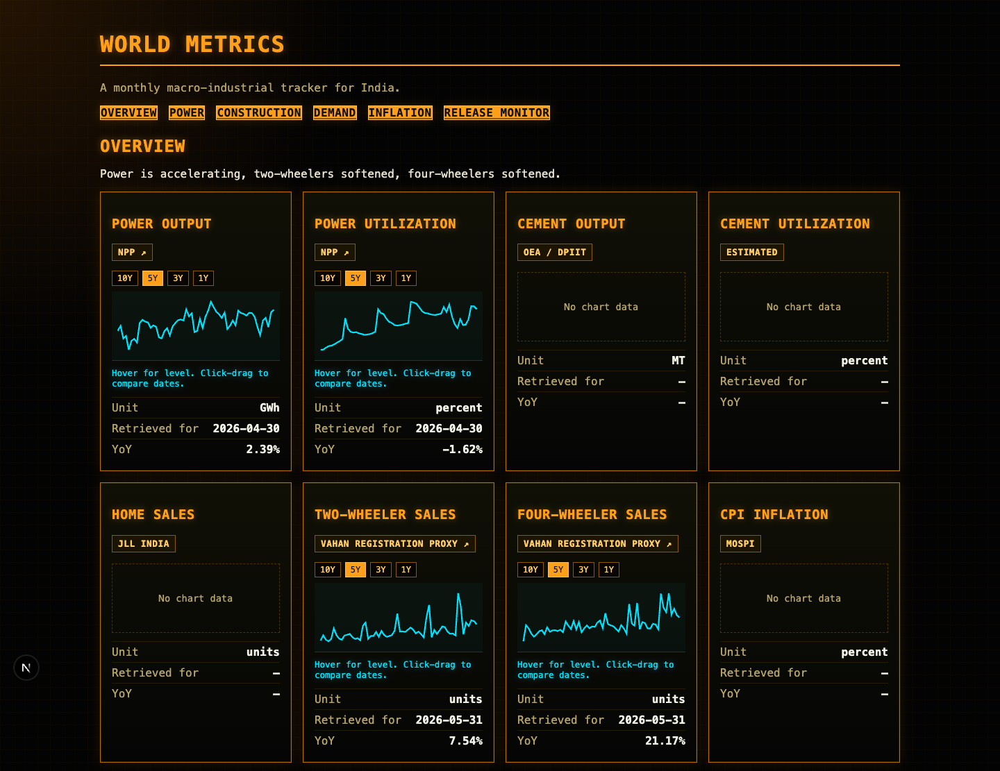

# World Metrics

India macro-industrial dashboard for tracking power, construction, demand, inflation, and daily FII equity flows.



## What it tracks

Current v1 metric scope:

- Power output
- Power utilization / thermal PLF
- Cement output and cement utilization estimate
- JLL residential home sales
- VAHAN two-wheeler and four-wheeler registration proxy data
- CPI inflation
- FII/FPI equity cash-market flows: daily net totals in ₹ crore, with a monthly-sum toggle

## Current local status

The local dashboard uses generated snapshots in `web/data/`. The shareable edition in `site/` reads validated cloud snapshots from `published-data/`; those public economic-data snapshots are intentionally committed for unattended updates.

The current implementation includes live/local connector support for:

- **NPP Monthly Generation Reports** via Playwright form submission and XLS parsing for power output and thermal PLF
- **VAHAN dashboard retrieval workflow** via the `vahan-dashboard` skill for two-wheeler and four-wheeler registration proxy data
- Unattended release discovery/parsing for ICRA cement, JLL residential sales, and MoSPI CPI in the cloud collector; legacy connector/fixture paths remain available for local development.

The frontend surfaces connector gaps directly in the dashboard and Release Monitor instead of silently substituting fake data.

## Architecture

```text
backend/   Python ingestion jobs, connectors, parsers, validators, transforms
sql/       PostgreSQL schema and seed metadata for production-style persistence
web/       Next.js dashboard, API/data helpers, generated local snapshots
scripts/   Local development helper scripts
docs/      Implementation notes, refresh docs, plans, and screenshots
```

## Quick start

### 1. Install frontend dependencies

```bash
cd web
npm install
```

### 2. Create backend virtual environment

```bash
cd backend
python -m venv .venv
source .venv/bin/activate
pip install -r requirements.txt
```

### 3. Refresh local data

From the project root:

```bash
npm run refresh
```

For a smaller development window:

```bash
npm run refresh:16
```

To wipe local generated data and force a clean repopulation:

```bash
npm run reset:data
```

### 4. Run the dashboard

From the project root:

```bash
npm run dev
```

Open `http://localhost:3000`.

## Useful commands

```bash
npm run dev        # run the Next.js dashboard
npm run build      # production frontend build with auto-refresh disabled
npm run refresh    # refresh 60 months of local data
npm run refresh:16 # faster 16-month refresh
npm run refresh:fii # refresh daily FII flows without running the macro collectors
npm run reset:data # remove local SQLite DB and generated dashboard JSON
```

Backend commands can also be run directly:

```bash
cd backend
source .venv/bin/activate
python -m app.main refresh-dev --reset-db --months 60
python -m app.main personal-tracker
```

## Data and generated files

Generated runtime artifacts are excluded from Git, including:

- `backend/data/*.sqlite3`
- `web/data/*.json`
- `web/.next/`
- `web/node_modules/`
- `backend/.venv/`

This keeps the repository focused on source code, documentation, schema, and reproducible project setup.

## Production hardening still to do

- Make all backend tests deterministic without triggering slow live connector calls
- Add robust PDF/XLSX/HTML extraction for sources that do not publish stable APIs
- Persist raw source artifacts and extraction logs for auditability
- A separate always-on local deployment would need its own scheduler; published data already refreshes through GitHub Actions.
- Move from dev SQLite snapshots toward the PostgreSQL schema if/when needed

## FII equity flows

The Overview has a daily FII/FPI chart with a Daily / Monthly toggle. Positive values are net buying and negative values are net selling, in ₹ crore. The monthly view sums the dated daily observations; the current month is marked month to date, and historical months with gaps are marked partial. Buy and sell totals are available in the chart readout and data table.

The latest provisional figure comes from NSE's combined NSE/BSE/MSEI cash-market report. Historical daily figures are backfilled from Groww's cash-market data and accepted only when an overlapping record agrees with NSE. Historical coverage is checked against the available official exchange calendar, and unverified or missing sessions are disclosed. These figures exclude equity derivatives and primary-market flows.

FII data uses its own `web/data/fii-flows.json` snapshot. Opening the dashboard and its background polling trigger a separate lightweight refresh: every 15 minutes after 15:30 IST on weekdays, every six hours otherwise, and on the first check of a new India calendar day. Failed refreshes retry after five minutes and retain the last downloaded records. A new day's figure appears when NSE publishes it; unpublished days are never filled with zero. This refresh runs while the local app is being used; a closed app does not run a scheduled collector.

Use `npm run refresh:fii` for an immediate manual refresh. Set `WM_FII_AUTO_REFRESH=0` to disable automatic FII fetching independently of the macro refresh setting. The endpoint `/api/fii-flows` returns the daily records, source dates, coverage notes, and refresh status without HTTP caching.

## Published dashboard and automatic updates

The shareable dashboard is [World Metrics](https://world-metrics-anuj.baaz1324.chatgpt.site).
Its source is in `site/`; the local application remains in `web/`.

[Refresh World Metrics data](https://github.com/no4jargon/worldMetrics/actions/workflows/refresh-world-metrics.yml)
runs daily at approximately **20:30 Asia/Kolkata (15:00 UTC)**, and can also be started with **Run workflow**.
The job collects official NPP power reports, VAHAN registrations, MoSPI CPI releases,
ICRA cement reports, JLL residential reports, and NSE FII cash-equity flows.
It validates observations, merges new periods and revisions into retained history,
and commits a single `published-data/snapshot.json` bundle to this repository.
A blocked or changed source retains its last verified observations and reports its
failure in the bundle and Release Monitor; missing publications are never filled with zeros.
Cement utilization remains unavailable until an explicit source is connected.

The published site loads the current public GitHub bundle when opened and checks again
every 15 minutes while open. Data updates do not require a website redeployment or this
computer to be running. If GitHub cannot be reached, the page keeps its bundled or last
successfully loaded figures and shows the last check time. Source reporting periods
remain visible separately from the collector's check time.

To run the same cloud collector locally after installing the backend dependencies:

```sh
python -m pip install -r backend/requirements.txt
python -m playwright install chromium
PYTHONPATH=backend python -m app.pipelines.cloud_refresh --data-dir published-data
```

The workflow uses GitHub's repository-scoped automation token; no paid API key is
needed. The published frontend is deployed through Sites; UI changes still require
building and publishing a new Site version. `site/.openai/hosting.json` preserves its
hosting identity. No credentials are committed.
